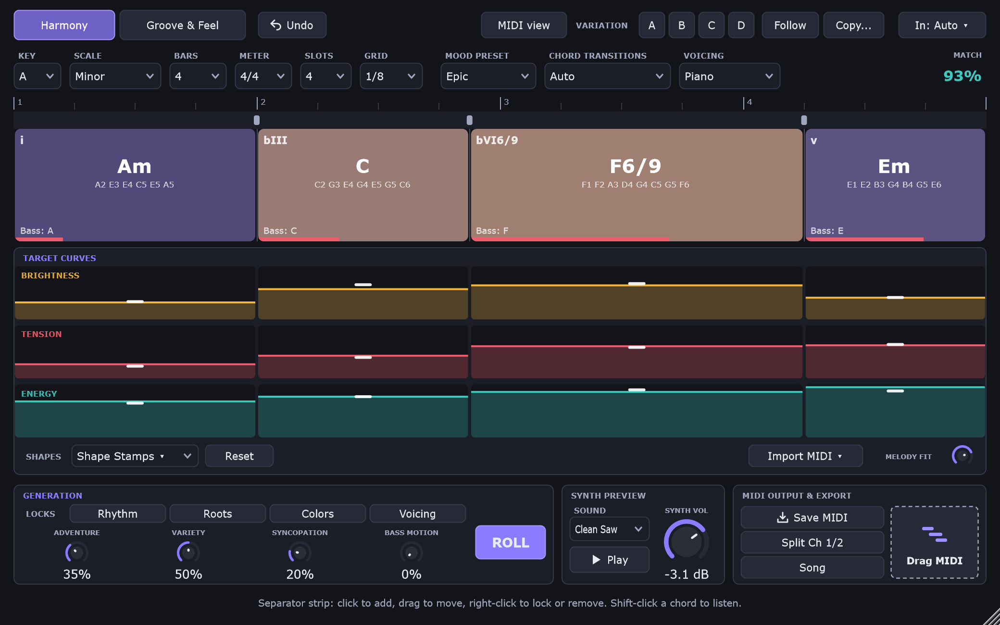
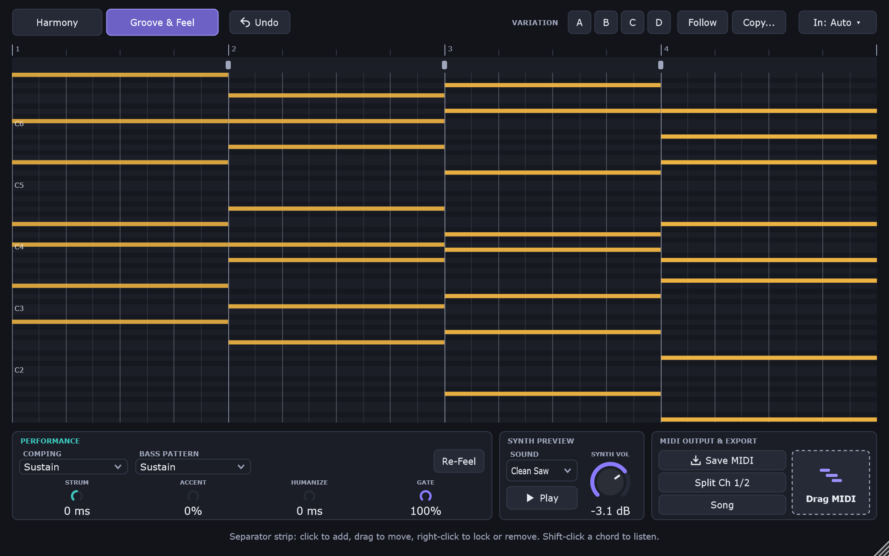

# ChordSlots

**Target driven harmony for producers.** Draw brightness, tension, and energy across a loop. ChordSlots searches for chords and voicings that follow those curves, then sends or exports the result as MIDI.

[Download ChordSlots v0.3.0 for testing](https://github.com/lagosproject/chordslots/releases/tag/v0.3.0) · [Release notes](RELEASE_NOTES_v0.3.md)



ChordSlots is a JUCE instrument plugin with an optional CLAP build. Its preview synth can play the result, and its MIDI output can drive another instrument or become a dragged MIDI clip.

## What it does

- **Draw a progression by feel.** Edit up to 16 slots over as many as 8 bars. Move or add cuts and set each slot's Brightness, Tension, and Energy targets. Match averages the per-slot scores based on the differences between measured and target Brightness and Tension.
- **Shape harmony.** Choose key, scale, mood, Chord Transitions, and voicing. Each mood supplies initial target curves. Rolls select chords to match those curves. Adventure controls how far the candidate pool reaches beyond diatonic chords. The sampler accounts for transitions around the loop, while Variety sets its sampling temperature.
- **Edit and keep good ideas.** Lock a slot or layer before rolling again. Choose chord alternatives, undo edits, and keep four independent variations (A–D). Switch immediately, on the next slot, or on the next bar.
- **Harmonize a melody.** Import a MIDI melody and set Melody Fit to make sustained notes and stronger beats influence chord selection. Set Melody Fit to zero to ignore the imported melody.
- **Give the bass its own part.** Choose a chord inversion or slash bass, set Bass Motion, and select Sustain, octave pump, offbeat eighths, 808 legato, or walking patterns. Split output sends upper chords on MIDI channel 1 and bass on channel 2.
- **Arrange a song.** Build a chain of up to 16 entries. Each entry selects a variation and signed semitone transposition. Song playback follows the chain. Drag Song exports it as a MIDI clip with chord and section markers. Drag Chords and Drag Bass export individual parts.
- **Perform and export.** Use Strum, Accent, Humanize, and Re-Feel to shape timing and velocity. Host playback follows tempo and position. Incoming MIDI can trigger slots with selectable mapping and held-note priority. MIDI export includes the current performance timing.

Use **Harmony** to shape a progression, then open **Groove & Feel** to adjust bass patterns, comping, timing, and dynamics with the MIDI preview in view. Both tabs share variation selection, Undo, synth preview, and MIDI export.



## How the musical model works

Metrics are computed from the generated notes and their interval properties.

See the [research notes](docs/BASE-DE-INVESTIGACION.md) for the studies, benchmarks, and internal audit findings behind the ongoing review of these controls.

| Target | What is measured |
| --- | --- |
| **Brightness** | Chord quality, colour relative to the key and upper-voice register. The target guides chord choice and voicing register when a slot regenerates. |
| **Tension** | Harmonic tension in context, combining the voiced chord's local tension, distance from the key and movement from the previous chord, including across the loop boundary. The target guides slot regeneration. |
| **Energy** | MIDI velocity and voicing density, including bass and doublings. Editing Energy reapplies the targets to voiced, unlocked slots while keeping their chords. Doublings depend on the target, voicing style and available register. |

The search scores candidate chords against slot targets and progression transitions. It then samples a progression before assigning voicings. The prior combines key-relative transitions from 890 McGill Billboard annotations and 200 RS200 songs. The major, minor, and extended-harmony groups contain 917, 173, and 377 annotations. The extended group includes songs in either mode with at least 30% extended chords. Sparse rows use interpolated unigram backoff. Adventure adjusts the prior's influence.

Corpus preparation normalizes chord symbols relative to the annotated tonic, groups them by quality, collapses repeated symbols, and aggregates transitions. The prior uses the Billboard partition from ChoCo and RS200 analyses from their source archive. See [DATA_LICENSES.md](DATA_LICENSES.md) for source links, checksums, exclusions, and attribution.

## Build

Build with CMake 3.22 or later and a C++17 compiler. JUCE 9.0.5 is fetched by CMake unless a checkout exists at `third_party/JUCE`.

```sh
cmake -S . -B build -DCMAKE_BUILD_TYPE=Release
cmake --build build --config Release --parallel
ctest --test-dir build --build-config Release --output-on-failure
```

The default build creates VST3 and Standalone formats. macOS also builds AU. Non-Apple builds add LV2. Outputs are below `build/ChordSlots_artefacts/Release/`.

| Format | Output | Install or run |
| --- | --- | --- |
| VST3 | `VST3/ChordSlots.vst3` | Windows `%CommonProgramFiles%/VST3`<br>macOS `/Library/Audio/Plug-Ins/VST3` or `~/Library/Audio/Plug-Ins/VST3`<br>Linux `~/.vst3`. |
| AU instrument on macOS | `AU/ChordSlots.component` | `~/Library/Audio/Plug-Ins/Components/` or the system Components folder. |
| LV2 on non-Apple builds | `LV2/ChordSlots.lv2` | Linux hosts commonly scan `~/.lv2`. Other host paths are configurable. |
| Standalone | `Standalone/` | Launch the generated application or executable. |

Set `-DCHORDSLOTS_COPY_AFTER_BUILD=ON` to ask JUCE to copy supported formats into user plugin locations after the build. A normal build leaves packages in the output folders above.

### Optional CLAP

CLAP is opt-in and uses the MIT-licensed `clap-juce-extensions` adapter. Ordinary builds skip that dependency. Configure and build the CLAP target with these commands.

```sh
cmake -S . -B build-clap -DCMAKE_BUILD_TYPE=Release -DCHORDSLOTS_BUILD_CLAP=ON
cmake --build build-clap --config Release --target ChordSlots_CLAP
```

For an offline build, point CMake's FetchContent source override at a recursive adapter checkout that includes its submodules. Use this command.

```sh
cmake -S . -B build-clap -DCMAKE_BUILD_TYPE=Release \
  -DCHORDSLOTS_BUILD_CLAP=ON \
  -DFETCHCONTENT_SOURCE_DIR_CLAP_JUCE_EXTENSIONS=C:/deps/clap-juce-extensions
```

The plugin accepts and emits MIDI. Its output is `build-clap/ChordSlots_artefacts/Release/CLAP/ChordSlots.clap`. Common scan locations are `%CommonProgramFiles%/CLAP` on Windows, `~/Library/Audio/Plug-Ins/CLAP` on macOS, and `~/.clap` on Linux.

On Windows, the full `clap-validator` run completed with 32 passed, 0 failed, 1 warning, and 11 skipped. The `state-invalid-random` warning says the wrapper reported a successful nonempty random-state load while the plugin remained stable. The integrated CTest also passed direct CLAP MIDI note input through to generated chord note-ons and note-offs. A DAW smoke test is still needed to verify host-level routing.

### macOS AU MIDI FX for Logic

The **ChordSlots MIDI FX** AU is a separate MIDI processor for Logic's MIDI FX slot. Build it with this command.

```sh
cmake --build build --config Release --target ChordSlotsMidiFX_AU
```

The component is written under `build/ChordSlotsMidiFX_artefacts/Release/AU/ChordSlots MIDI FX.component`. Copy it to `~/Library/Audio/Plug-Ins/Components/`, then check registration with this command.

```sh
auval -v aumi ChsM Chsl
```

For the Logic smoke check, rescan Audio Units, create a software-instrument track, and insert **ChordSlots MIDI FX** before the instrument. Open its editor, press **ROLL**, then start Logic playback. Confirm the downstream instrument plays the generated chords and bass, the MIDI FX remains silent, and the normal **ChordSlots** instrument still works. This physical Logic check requires a Mac with Logic and remains pending.

### Tests and useful tools

CTest runs `core`, `performance`, `trigger`, `plugin`, and `eval`. macOS builds also run `midi_fx`, which checks the AU MIDI processor's identity, bus layout, and MIDI output. The plugin suite runs the real processor with simulated host transport and checks MIDI/audio behavior, save/restore, and export. `eval` compares musical metrics with a committed Linux baseline. CI skips that comparison on macOS and Windows.

Render a screenshot without opening a DAW.

```sh
build/chordslots_plugin_tests --snapshot ui.png
build/chordslots_plugin_tests --snapshot groove.png 0 --groove
```

Build only the header-only musical core and CLI.

```sh
cmake -S . -B build-core -DCHORDSLOTS_BUILD_PLUGIN=OFF
cmake --build build-core --config Release
./build-core/chordslots-cli roll all 5
./build-core/chordslots-cli table 1
```

Debian and Ubuntu builds need the usual compiler, CMake, ALSA, X11, Freetype, and Fontconfig development packages. `scripts/fetch-linux-headers.sh` can prepare X11 and ALSA headers for an unprivileged local build.

## Verification and limitations

- The final **ChordSlots MIDI FX in Logic** check requires a Mac with Logic. Confirm that an instrument on the same track plays MIDI generated by the MIDI FX.
- The GitHub Actions CI workflow builds and validates Linux, macOS, and Windows targets. See the release assets for packaged downloads.
- CLAP validator and direct MIDI-path checks pass. A DAW smoke test remains to confirm host-level MIDI routing.
- Use evaluation as a regression guard. Musical preference still needs listening across hosts and projects.

## Licence

ChordSlots is licensed under the GNU Affero General Public License v3 or later (see [LICENSE](LICENSE)). Source data licences and attribution for derived corpus counts are in [DATA_LICENSES.md](DATA_LICENSES.md). JUCE is used under the terms documented by its project. VST is a registered trademark of Steinberg Media Technologies GmbH.
