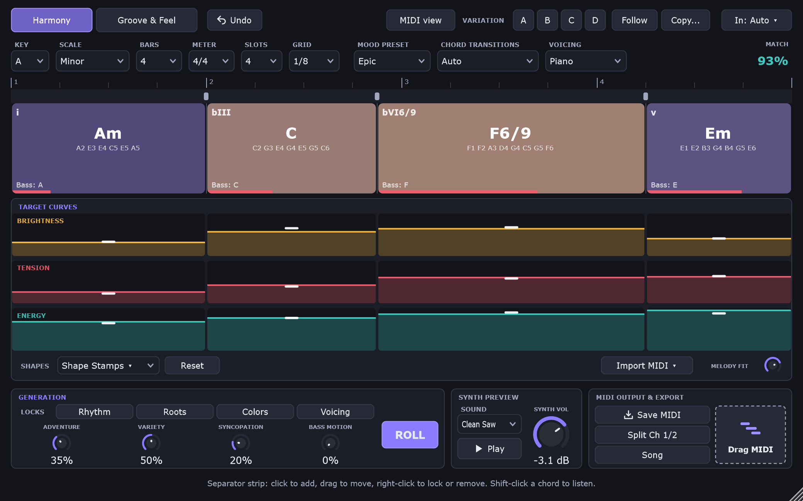
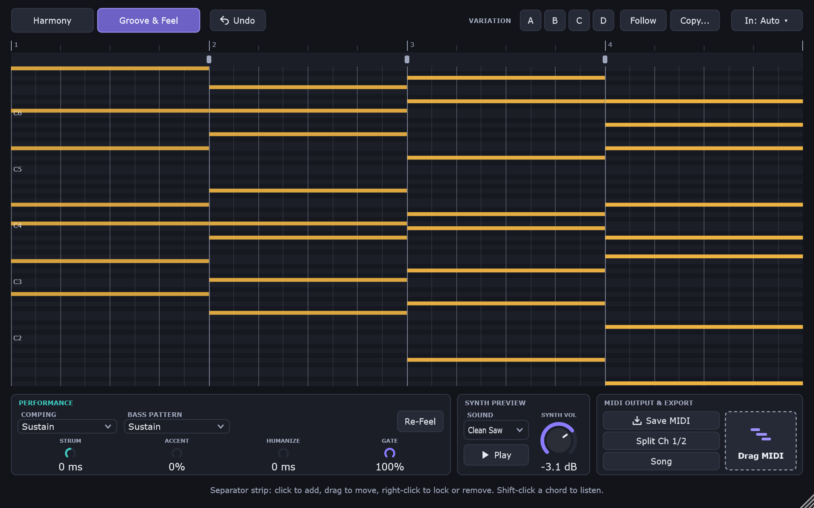

# ChordSlots 0.3.0 Test Release

Build a progression in **Harmony**, then use **Groove & Feel** to shape its performance. Undo, variation selection, synth preview, and MIDI export are available in both tabs.

- The Harmony timeline lines up with the Brightness, Tension, and Energy lanes. Shapes, Reset, Import MIDI, and Melody Fit sit below the curves.
- Groove & Feel shows a larger MIDI preview and groups Bass Pattern, comping, gate, strum, accent, humanize, and Re-Feel.
- The chord-alternative plot lets you compare, audition, and swap candidates.

## Try it on Windows

1. Download and extract `ChordSlots-v0.3.0-Windows-x64.zip` from the release assets.
2. For the standalone app, open `ChordSlots.exe`.
3. For a DAW, copy the entire `ChordSlots.vst3` bundle to your VST3 scan location, usually `C:\Program Files\Common Files\VST3`, and rescan in the DAW.
4. Draw a curve, roll a progression, audition it, and drag MIDI onto an instrument track. Then try changing a bass pattern or a groove control.

If you find an issue, include your operating system, DAW and version, plugin format, and the steps to reproduce it.

## Editor screenshots

